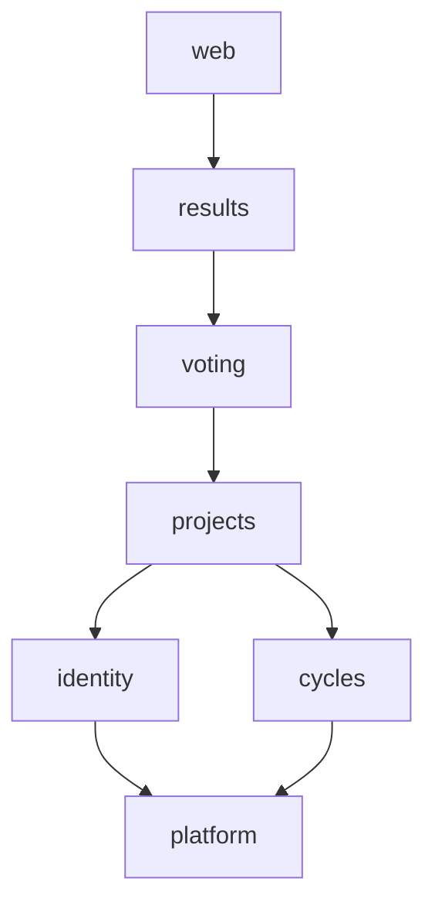
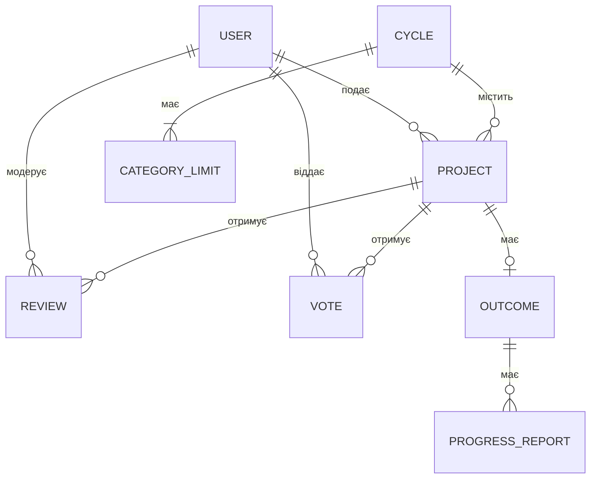

# Громадський бюджет міста: специфікація системи

Живий документ: змінюється разом з ADR або за результатами аудиту.
Формат: [standards/spec-format.md](standards/spec-format.md).

## Що і навіщо

Вебсервіс для повного циклу громадського бюджету: мешканці подають проєкти,
міськрада їх модерує, мешканці голосують, система визначає переможців у межах
бюджету й показує хід реалізації. Мета: кожне рішення (допуск, голос, перемога)
випливає з перевірюваних правил, а не з ручної таблиці.

Ролі: мешканець (верифікований через BankID, у прототипі заглушка), автор
проєкту, модератор, адміністратор.

## Компоненти і взаємодія

Модульний моноліт ([ADR-0002](adr/0002-modular-monolith.md)). Кожен модуль
оформлено як пакет `civic_budget/<модуль>`. Стрілка означає «використовує»; вищий модуль
може використовувати будь-який нижчий, а нижчий вищого ніколи.

| Модуль | Відповідає за | Володіє даними |
|---|---|---|
| `web` | HTTP: роутери, збирання застосунку, `/health`, `/version` | – |
| `results` | підрахунок голосів, переможці, хід реалізації | Outcome, ProgressReport |
| `voting` | голоси і правила голосування | Vote |
| `projects` | заявки, модерація, статуси заявок | Project, Review |
| `identity` | користувачі, ролі, верифікація | User |
| `cycles` | раунд: фази, дати, бюджети категорій | Cycle, CategoryLimit |
| `platform` | налаштування, годинник, версія збірки | – |

## Дані

Гроші зберігаються в цілих копійках, час в UTC.

- User: id, full_name, role, tax_id_hash (унікальний), verified_at
- Cycle: id, title, submission_from, submission_to, voting_from, voting_to, max_votes, min_votes
- CategoryLimit: (cycle_id, category: small | large), budget, max_cost
- Project: id, cycle_id, author_id, category, title, cost, status, submitted_at
- Review: id, project_id, moderator_id, decision, reason, decided_at
- Vote: (voter_id, project_id), cycle_id, cast_at
- Outcome: project_id, votes, rank, funded, decided_at
- ProgressReport: id, project_id, spent, note, reported_at

## Сценарії оновлення даних

1. **Подання.** Верифікований автор у фазі подання: `projects` створює Project
   зі статусом submitted. Фазу і max_cost категорії бере з `cycles`,
   верифікацію автора з `identity`.
2. **Модерація.** До початку голосування модератор в одній транзакції додає
   Review і переводить Project із submitted в approved або rejected. Для
   rejected причина обов'язкова.
3. **Голос.** Верифікований мешканець у фазі голосування: `voting` додає Vote
   за approved-проєкт цього раунду. Не більше max_votes голосів на раунд,
   один голос на проєкт, скасувати не можна.
4. **Підсумки.** Після кінця голосування адміністратор запускає підрахунок.
   `results` отримує від `voting` готову кількість зарахованих голосів на
   проєкт (які голоси зараховуються, вирішує лише `voting`), проєкти з
   `projects`, бюджети з `cycles`. У кожній категорії сортує за голосами (за рівності раніше
   поданий вище) і бере кожен проєкт з votes не менше min_votes, який ще
   вміщається в залишок бюджету. Outcome пишеться для кожного
   approved-проєкту; повторний запуск дає той самий результат.
5. **Реалізація.** Для funded-проєкту додається ProgressReport; сума spent
   не перевищує cost проєкту.

## Правила меж

R1, R2 і R4 перевіряє `make contracts` (import-linter, контракти в
`pyproject.toml`), R3 перевіряють тести і рев'ю.

- R1. Модулі залежать один від одного лише згори вниз за схемою, без циклів.
- R2. Інший модуль імпортує лише сам пакет модуля
  (`from civic_budget.projects import ...`), а не його підмодулі.
- R3. Таблицю пише лише модуль-власник. Інші модулі читають її через його
  API і отримують результат його правил (наприклад, кількість зарахованих
  голосів), а не сирі записи, які довелося б обробляти повторно.
- R4. Вебфреймворк (`fastapi`) використовує лише `web`; доменні модулі від
  нього не залежать.
